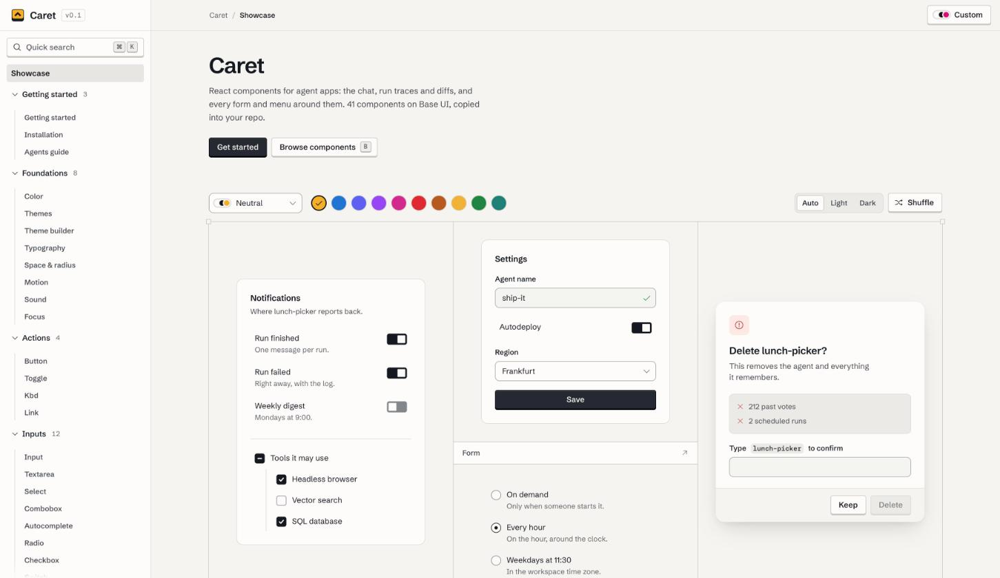

<picture>
  <source media="(prefers-color-scheme: dark)" srcset=".github/assets/showcase-dark.jpg">
  
</picture>

# Caret

**React components for agent apps:** the chat, run traces, logs and diffs, and every form and menu
around them. 41 components on [Base UI](https://base-ui.com), eight themes in light and dark, and a
keyboard path for every control. Copy them into your repo and they're yours.

Caret is a design system for tools where people and agents build software together. It's built
for the parts those tools share: a conversation with an agent, the steps of a run, output that's
still arriving, and settings that take effect the moment they flip.

## What's inside

| Group | Components |
|---|---|
| **Agents** | Chat (messages, trace, composer, context meter), Timeline, Log stream |
| **Actions** | Button, Toggle, Kbd, Link |
| **Inputs** | Input, Textarea, Select, Combobox, Autocomplete, Radio, Checkbox, Switch, Slider, Number field, OTP field, Form |
| **Overlays** | Command palette, Tooltip, Popover, Preview card, Menu, Context menu, Menubar, Dialog, Drawer |
| **Structure** | Card, Table, Key value, Tabs, Accordion, Collapsible, Separator, Scroll area, Navigation menu |
| **Feedback** | Progress, Meter, Toast, Callout |
| **Templates** | Agent workspace, Run detail, Settings, composed only from the parts above |

**Foundations.** Every color, radius, duration and shadow is a named token. Eight themes (Neutral,
Zinc, Stone, Slate, Indigo, Teal, Sand and Contrast), each light and dark, plus nine primary colors
that work in all of them. A theme solver generates the tokens and **fails the build if any pairing
drops below its contrast target**, so a theme can't ship unreadable text. A theme builder in the docs
makes custom themes with the same guarantees.

**Details that come with every component:**

- A full keyboard path and the right ARIA state, built on Base UI primitives
- Every state visible: hover, pressed, focus, selected, disabled, loading, invalid
- 36px controls on a whole-pixel grid, so edges stay sharp at 100%, 125% and 150% scaling on Windows
- Motion that answers what you did and nothing else, and respects reduced motion
- Optional sound feedback, off until someone turns it on
- Phosphor icons, and 44px touch targets on coarse pointers

## Principles

1. **State is visible.** Every control shows what it's doing. The docs do too: every specimen
   carries a live state readout, like an editor's status bar.
2. **Tokens are typed, not guessed.** A design decision you can't reference by name will drift.
3. **One proportion, finished.** Each component has one size, tuned until it feels right. A smaller
   one exists only where dense chrome needs it.

The full rules, from color pairings to motion curves, are in [DESIGN.md](DESIGN.md).

## Use it in your app

Caret is source you own, not a package. You need React 19, Tailwind CSS v4 and Base UI.

**1. Install the stack**

```sh
pnpm add react react-dom @base-ui/react @phosphor-icons/react motion clsx tailwind-merge
pnpm add -D tailwindcss @tailwindcss/vite
```

**2. Copy the source.** Take `src/styles` (the tokens and their Tailwind mapping), the helpers the
components use from `src/lib` (`cn`, `motion`, `sound`, `theme` and the `palette` it builds on), and
the components you want from `src/components`. Import the styles once:

```css
@import "tailwindcss";
@import "./tokens.css";
@import "./components.css";
```

**3. Mount the providers** at your app's root:

```tsx
import { IconContext } from "@phosphor-icons/react";
import { MotionConfig } from "motion/react";
import { ToastProvider, TooltipProvider } from "@/components";
import { settle } from "@/lib/motion";

<MotionConfig reducedMotion="user" transition={settle}>
  <IconContext.Provider value={{ size: 16, weight: "regular" }}>
    <TooltipProvider>
      <ToastProvider>
        <App />
      </ToastProvider>
    </TooltipProvider>
  </IconContext.Provider>
</MotionConfig>
```

Then pick a theme with `data-theme` and `data-mode` on any element; both scope, so one page can
show several themes at once.

## Run the docs

The docs site is the best way to see everything: every component live, with its states, its
keyboard behaviour and a readout of what it's doing.

```sh
pnpm install
pnpm dev
```

It needs Node 22.6 or later. `pnpm build` typechecks and builds the site, and `pnpm tokens`
regenerates the theme tokens and checks every contrast pairing.

## Working with coding agents

Caret is written to be used by agents as well as people. The docs build serves `llms.txt` (every
page with its exports), `llms-full.txt` (every rule as well) and `agents.md` (a file to drop into
your repo as `AGENTS.md`), so an agent composes from existing components instead of inventing new
ones.

## Contributing

Bug reports, fixes and ideas are welcome. Read [CONTRIBUTING.md](CONTRIBUTING.md) for setup and
the rules every change follows.

## License

[MIT](LICENSE) © Rashmita Parmanik. The bundled fonts, Schibsted Grotesk and Paper Mono, are
under the SIL Open Font License 1.1.
